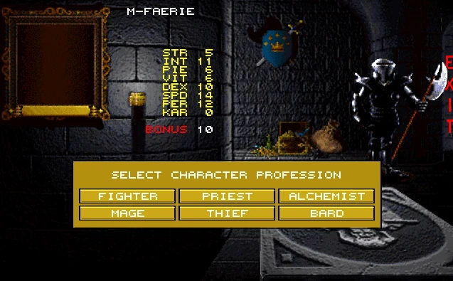
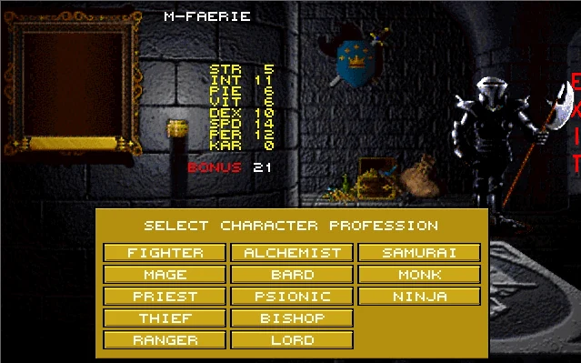
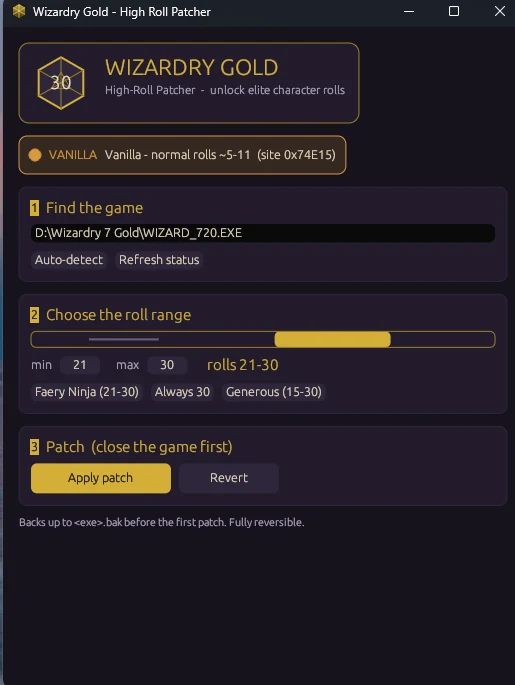

# Wizardry Gold — High Roll Patch

A tiny, reversible binary patch for the single-player game **Wizardry 7:
Crusaders of the Dark Savant** (the "Wizardry Gold" Windows re-release,
`WIZARD_720.EXE` / `WIZARD.EXE`).

It forces the character-creation **bonus-points roll** into the game's own hidden
"elite" range of **21–30**, so high-requirement classes like the famously rare
**Faery Ninja** are selectable at creation — without grinding hundreds of
rerolls.

> The patch flips a developer flag the game already ships with (but keeps
> disabled). The roll is still generated by the game's own code; nothing about
> the value is faked. See [WRITEUP.md](WRITEUP.md) for the full reverse-engineering
> story, or [BLOG.md](BLOG.md) for a plain-English version.

## Screenshots

Same character (a male Faery), before and after the patch — the bonus roll jumps
from **10** to **21**, and the profession list gains Samurai, Monk, Bishop, Lord,
Psionic and the prize: **Ninja**.

| Before — Bonus 10, no Ninja | After — Bonus 21, Ninja unlocked |
|:---:|:---:|
|  |  |

The patcher itself:



## Requirements

- Windows, Python 3.x (the patcher uses only the standard library).
- A legally-owned copy of Wizardry Gold installed locally.

## Two ways to use it

- **GUI (easiest, no Python):** a single standalone `.exe` — double-click, set a
  roll range, click **Apply**. See [GUI](#gui-1-click).
- **Command line (Python):** `patch_wizgold.py`, stdlib only.

## Command line

Close the game first (the exe is locked while it runs), then:

```sh
python patch_wizgold.py            # apply the patch (auto-detects the game)
python patch_wizgold.py --status   # show current state
python patch_wizgold.py --revert   # undo the patch
```

If auto-detect can't find the game, pass the path or set an env var:

```sh
python patch_wizgold.py "D:\Wizardry 7 Gold\WIZARD_720.EXE"
# or
set WIZGOLD_EXE=D:\Wizardry 7 Gold\WIZARD_720.EXE
python patch_wizgold.py
```

Then launch the game and create a character:
**name → Faery → gender → bonus rolls 21–30 → pick Faery Ninja** → allocate
points → finish normally.

## GUI (1-click)

A standalone graphical version lives in [`gui-rs/`](gui-rs/) (Rust). It's a single
~3 MB `.exe` with no dependencies — non-technical users just download and
double-click. It auto-detects the game, shows the current state, lets you pick a
roll range (or a preset like "Faery Ninja 21-30"), and applies/reverts with one
click. (Apply/Revert act on every game-exe copy in the folder — `WIZARD.EXE` and
`WIZARD_720.EXE` — so it doesn't matter which one the launcher runs.)


Build it:

```sh
cd gui-rs
cargo build --release
# -> gui-rs/target/release/wizgold_highroll_gui.exe
```

(Requires the [Rust toolchain](https://rustup.rs). Ship the resulting `.exe` to
end users; they don't need Rust or Python.)

## Safety

- **Backs up** the exe to `<exe>.bak` before the first patch.
- **Verifies** the exact bytes (by signature) before writing; refuses on an
  unknown build to avoid corruption.
- **Reversible** with `--revert`.
- While patched, **every** character creation rolls 21–30, not just Faery. Revert
  when you're done if you want normal rolls back.

## How it works (short version)

The roll generator normally produces ~5–11 points. Buried inside it is a dormant
branch: *if the flag at `0x4A20A0` equals 1, roll `random(10)+21` (21–30)*. The
shipped game forces that flag to `0`, so the branch never runs. The patch NOPs
the 6-byte conditional jump guarding the branch, so the elite roll always fires.

Because eligibility for a profession is computed from the rolled total (which is
now genuinely high), Faery Ninja becomes selectable. Editing the bonus *value* in
memory never worked because eligibility is decided from the roll at the instant
you pick a gender — full story in [WRITEUP.md](WRITEUP.md).

## Repo contents

| File                  | Purpose                                                       |
|-----------------------|---------------------------------------------------------------|
| `patch_wizgold.py`    | The patch tool (apply / revert / status). Stdlib only.        |
| `patch_timer.py`      | Fixes a vanilla timing bug that makes ambient birds/bats/sounds run at absurd speed. Stdlib only. |
| `patch_speed.py`      | Game speed, message/combat text dwell, screen-wipe delay. Stdlib only. |
| `analyze.py`          | Dev: find & disassemble code references to an address.        |
| `disasm_range.py`     | Dev: linearly disassemble a virtual-address range.            |
| `wdis.py`             | Dev: disassemble an arbitrary VA range (`wdis.py <start> <end>`). |
| `wizgold_highroll.py` | The original runtime memory tool (superseded by the patch).   |
| `WRITEUP.md`          | Full technical write-up.                                       |
| `BLOG.md`             | Non-technical explanation.                                     |

**Patch the right exe.** The GOG `Launch.exe` picks which executable to run from
the resolution you choose — "Desktop resolution" runs `WIZARD.EXE`, but
"1280x720 (Large game window)" runs `WIZARD_720.EXE`. Patch **both**, or your
changes may appear to do nothing. See [docs/LAUNCHER.md](docs/LAUNCHER.md).

The `analyze`/`disasm`/`wdis` scripts are only needed to **reproduce** the
research and require Capstone:

```sh
pip install -r requirements.txt
```

## Disclaimer

For personal use with a single-player, offline game you own. It modifies a local
copy of your own executable (with a backup, reversibly). No game files are
redistributed here. Use at your own risk.
